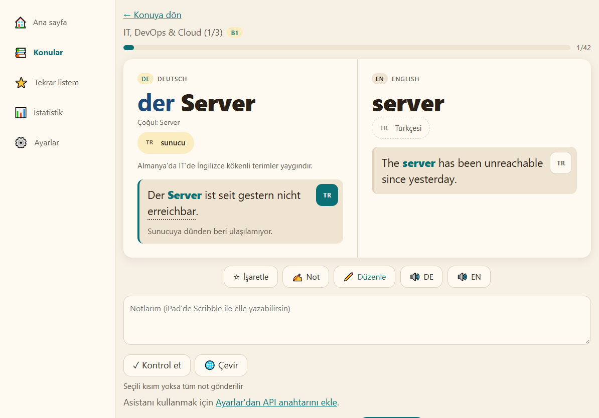
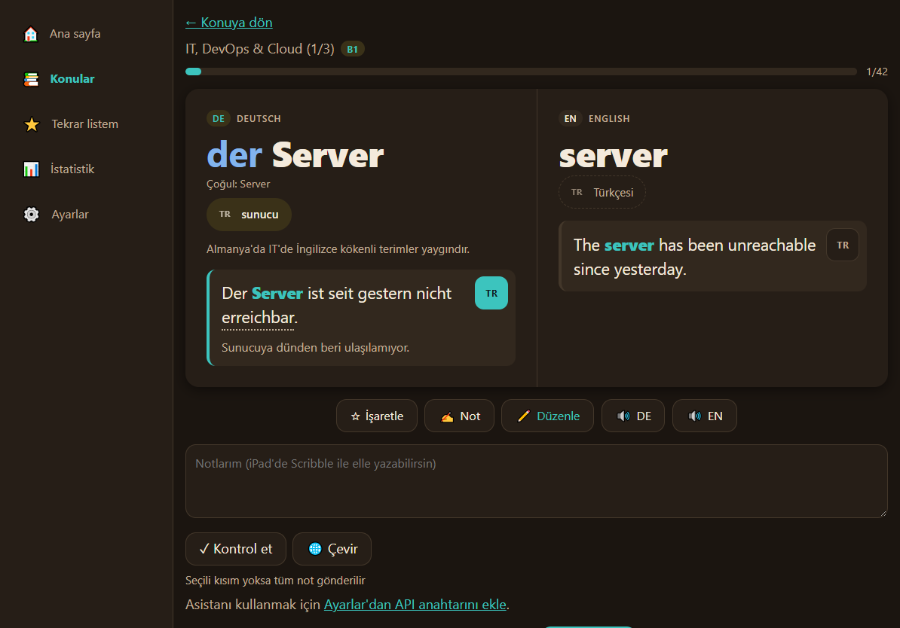
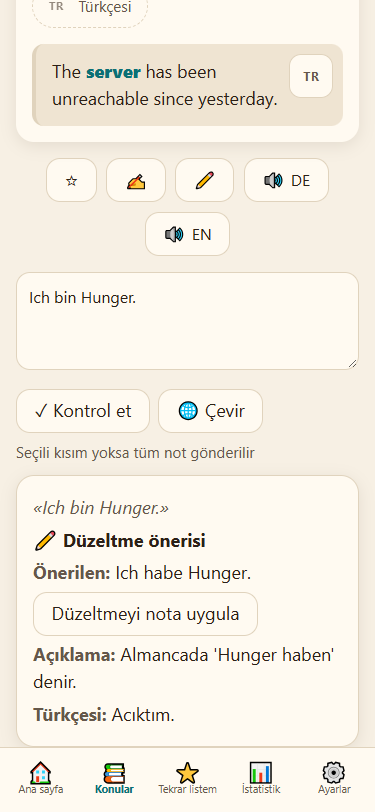

# Almanca Kartlar

[](https://github.com/EnesCetin96/almanca-kartlar/actions/workflows/ci.yml)


**iPad için çevrimdışı çalışan Almanca–İngilizce kelime kartı uygulaması** (PWA). Hedef: Almanya'da DevOps / Cloud işleri için çalışırken
Almanca ve İngilizce seviyeni B1'den B2'ye taşımak; kelimeleri iş, günlük hayat ve sınav konularına göre öğrenmek.
Her kelimenin Türkçe anlamı ve üç dilli örnek cümlesi var. Hesap, sunucu ya da analitik yok: tüm veri cihazında kalır.

> **English:** An offline-first flashcard PWA (German ⇄ English with Turkish meanings) built for iPad and Apple Pencil.
> 2,400+ cards in 62 topics (IT/DevOps, work, daily life, exam vocabulary), spaced repetition, four practice modes, handwritten notes.
> Plain ES modules, no build step, no runtime dependencies, no tracking. The UI is in Turkish.

**Canlı uygulama:** <https://enescetin96.github.io/almanca-kartlar/>

| Kart | Koyu tema | Telefon + asistan |
|---|---|---|
|  |  |  |

## Özellikler

- **2432 kart, 62 konu, 3 kategori:** İş (712 kart: IT/DevOps, işe başvuru, yönetim, finans, hukuk…), Günlük hayat (883: kafe, alışveriş, sağlık, seyahat, duygular…), Sınav (837: eğitim, bilim, toplum ve akademik kelimeler). B1–C1 seviyesi.
- **Kart yüzü:** Almanca (artikel renkli: der / die / das) ve İngilizce kelime yan yana; tek dokunuşla Türkçe anlam, her örnek cümlenin Türkçesi.
- **Aralıklı tekrar (SM-2 benzeri):** Tekrar / Zor / İyi / Kolay ile zamanlama, günlük hedef, seri ve istatistikler.
- **Dört çalışma modu:** kart çalış, çoktan seçmeli, yazarak cevap (artikel denetimli), boşluk doldurma.
- **Notlar:** karta yazılı not ve **Apple Pencil ile el yazısı** (basınç, silgi, geri al, avuç içi reddi).
- **Tekrar listem:** ⭐ ile işaretlediğin kelimeler.
- **Yapay zekâ asistanı (isteğe bağlı):** nota yazdığın cümleyi kontrol eder, hatayı Türkçe açıklar, çevirir. Kendi Anthropic API anahtarını gerektirir.
- **Kendi kartların:** elle ekle ya da CSV/JSON ile içe aktar; tek dosyalık yedek ve geri yükleme.
- **Görünüm:** dört renk paleti (Kahve & Turkuaz, Bordo & Altın, Lacivert & Turkuaz, Klasik), açık/koyu tema, telefon-tablet-masaüstü uyumu. Yazı/zemin kontrastı her palette en az 4,5:1.
- **Seslendirme:** cihazın kendi Almanca ve İngilizce sesleri.

## Kurulum (iPad)

1. Safari'de <https://enescetin96.github.io/almanca-kartlar/> adresini aç.
2. **Paylaş → Ana Ekrana Ekle**.
3. Bir kez internetle açıp birkaç saniye bekle; kartlar cihaza iner. Sonrasında uçak modunda da çalışır.
4. Yeni sürüm çıkınca alttan "Yeni sürüm var. Yenile" bildirimi gelir.

Safari, ana ekrana eklenmemiş sitelerin verisini silebilir. Uygulamayı ana ekrana ekle ve **Ayarlar → Yedeği dışa aktar** ile düzenli yedek al (uygulama 14 günde bir hatırlatır).

## Gizlilik

- Veriler (kartlar, ilerleme, notlar, çizimler) yalnızca tarayıcının IndexedDB/localStorage alanında durur. Hiçbir yere gönderilmez.
- Analitik, reklam, üçüncü taraf betik ya da yazı tipi yok.
- **Tek istisna, isteğe bağlı asistan:** "Kontrol et" ya da "Çevir" dediğin metin, senin API anahtarınla doğrudan Anthropic'e gider. Kart ve ilerleme verisi gönderilmez. Anahtar yedek dosyasına yazılmaz; "Tüm veriyi sil" onu da siler. Asistanı hiç kullanmazsan uygulama hiçbir yere bağlanmaz.

## Güvenlik

Ayrıntılar ve bildirim yolu için [SECURITY.md](SECURITY.md).

- Katı **Content-Security-Policy**: satır içi betik ve `eval` yok, yalnızca kendi kaynağı ve (asistan için) `api.anthropic.com`.
- Kullanıcı verisi hiçbir yerde HTML olarak yorumlanmaz (`textContent`); içe aktarılan CSV/JSON/yedek dosyaları doğrulanır, renk gibi alanlar sınırlanır.
- Başka bir sitenin çerçevesi içinde çalışmayı reddeder (clickjacking).
- Çalışma zamanı bağımlılığı yok; yayın iş akışındaki GitHub Actions sürümleri commit kimliğiyle sabitlenmiş.
- Her push'ta CI birim düzeyindeki güvenlik testlerini (içe aktarma doğrulaması, CSP kuralları) ve yasaklı kalıp taramasını (`innerHTML`, `eval`, `console.log`) çalıştırır; tarayıcıda CSP ve çerçeve korumasını `npm run security` ile yerelde sınarım.

## Teknik yapı

Saf **HTML + CSS + JavaScript (ES modülleri)**, derleme adımı ve çalışma zamanı bağımlılığı yok.

```
index.html, manifest.webmanifest, sw.js   PWA kabuğu ve çevrimdışı önbellek (sürümlü)
js/                                       uygulama (router, store, srs, practice, ai, ink/, views/)
css/                                      tokens.css (varsayılan palet), palettes.css, düzen ve bileşen stilleri
data/starter-decks.json                   derlenmiş kart içeriği
tests/                                    birim testleri (node:test) ve tarayıcı testleri (Playwright)
tools/                                    sürüm artırma ve yayın klasörü araçları
docs/                                     geliştirme notları ve ekran görüntüleri
```

- **Depolama:** IndexedDB (kartlar, desteler, tekrar durumu, el yazısı), ayarlar localStorage'da.
- **Hash router:** `#/`, `#/category/…`, `#/deck/…`, `#/study/…`, `#/session/…`.
- **Saf çekirdek:** zamanlayıcı (`srs.js`), alıştırma üretimi (`practice.js`), içe aktarma (`importers.js`) ve asistan (`ai.js`) DOM'a dokunmaz; birim testleriyle kapsanır.

## Geliştirme

```bash
python -m http.server 8080      # http://localhost:8080 (service worker localhost'ta çalışır)
npm test                        # birim testleri, ek paket gerektirmez
```

Tarayıcı testleri (`npm run smoke | layout | palettes | assistant | security`) Playwright ister; kurulum ve yayın adımları için [docs/DEVELOPMENT.md](docs/DEVELOPMENT.md).

## Kart içeriği hakkında

Kelime seçimi B1–C1 seviyesinde ve konulara göre gruplanmıştır. Almanca karşılıkların, Türkçe anlamların ve örnek cümlelerin çoğu yapay zekâ
yardımıyla hazırlandı ve her kelime Almanca bir sözlükle doğrulanmadı. Emin olunmayan kartlar uygulamada ve incelemede `review` ile işaretlidir.
Bir hata görürsen kartı uygulamada düzenleyebilir ya da bir issue açabilirsin. Sınav hazırlığında kritik bir bilgiyi Duden/DWDS gibi bir kaynakla teyit et.

## Durum

Kişisel öğrenme aracı olarak geliştiriliyor; gerçek cihaz kullanımına göre şekilleniyor. Lisans henüz belirlenmedi, bu yüzden kod ve içerik varsayılan olarak tüm hakları saklıdır.
